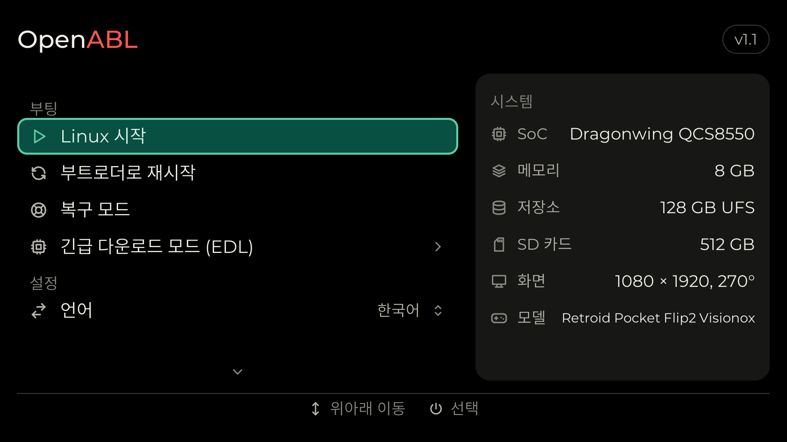
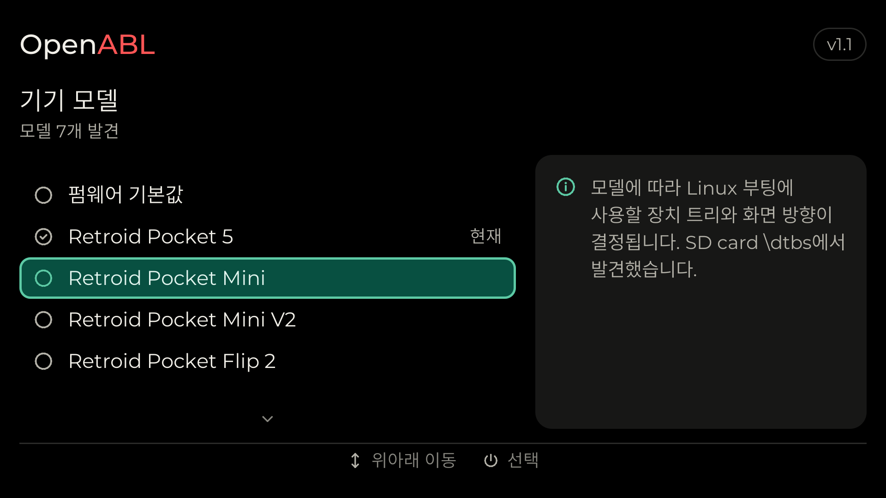

<picture>
  <source media="(prefers-color-scheme: dark)" srcset="Docs/logo-dark.png">
  
</picture>

Qualcomm 휴대용 기기를 위한 그래픽 부팅 메뉴와 표준 Linux 부팅 기능입니다.
Qualcomm의 Android 부트로더(ABL)에 통합되어 있으며, 기존 ABL에 패치 하나와
몇 개의 파일(`Abl/`)을 추가한 구조입니다. 펌웨어 볼륨에 메뉴 프로그램을 포함하고,
기존 fastboot 메뉴 대신 이 프로그램을 실행합니다.

<p>
  
  
</p>

시뮬레이터(`make sim`)로 렌더링한 한국어 메인 메뉴와 기기 모델 선택 화면입니다.

지원 칩셋: SDM845, SM4450, SM6115, SM6450, SM7675, SM8250, SM8550,
SM8650, SM8750.

## 사용 방법

사용하는 기기의 칩셋에 맞는 이미지를 ABL 파티션에 기록하세요.
A/B 기기는 양쪽 슬롯에 모두 기록합니다. 아래 명령은 SM8550의 예시입니다.

```bash
fastboot flash abl_a abl_signed-SM8550.elf
```

```bash
fastboot flash abl_b abl_signed-SM8550.elf
```

전원을 켤 때 누르고 있는 버튼에 따라 다음과 같이 동작합니다.

| 버튼 | 동작 |
|---|---|
| 누르지 않음 | 선택한 *부팅 위치*에서 현재 *부팅 모드*(Linux 또는 Android)로 부팅합니다. 부팅하지 못하면 메뉴를 열고 원인을 표시합니다. |
| 볼륨 낮춤 | 메뉴를 엽니다. 메뉴가 열려 있는 동안에도 USB fastboot를 사용할 수 있습니다. `fastboot reboot bootloader` 명령으로도 메뉴를 열 수 있습니다. |
| 볼륨 높임 | 부팅 모드가 Linux이면 Android로, Android이면 Android 복구 모드로 부팅합니다. *부팅 시 볼륨+ 버튼*을 *Linux (외부 저장소)*로 설정하면 SD 카드나 USB 드라이브의 Linux로 부팅합니다. |

메뉴에서는 볼륨 높임·낮춤 버튼으로 이동하고 전원 버튼으로 선택합니다.

| 항목 | 기능 |
|---|---|
| 시작 | 현재 부팅 모드로 부팅합니다(*Linux 시작* 또는 *Android 시작*). |
| 부팅 항목 | *시작*에서 시도할 대상을 순서대로 표시합니다. 부팅 항목, 각 드라이브의 `\EFI\BOOT\BOOTAA64.EFI`, 부팅 이미지 순입니다. 항목을 선택하면 해당 항목만 부팅합니다. 대상이 둘 이상일 때만 표시됩니다. |
| 부트로더로 재시작 | 메뉴로 재시작합니다. |
| 복구 모드 | Android 복구 모드로 재시작합니다. |
| 긴급 다운로드 모드 (EDL) | 확인을 거쳐 Qualcomm EDL 모드로 재시작합니다. |
| 다른 슬롯으로 부팅 | 다른 A/B 슬롯으로 전환합니다. A/B 기기에 표시됩니다. |
| 부팅 모드 | Linux 또는 Android를 선택합니다. |
| ABL 모드 | *출력 안 함* 또는 부팅 중 ABL 로그를 화면에 표시하는 *상세 출력*을 선택합니다. |
| 부팅 시 볼륨+ 버튼 | 전원을 켤 때 볼륨 높임 버튼을 누르고 있으면 수행할 동작을 설정합니다. |
| 부팅 위치 | 자동(내부 저장소 우선), 내부 저장소, SD 카드 또는 USB를 선택합니다. |
| 전원이 꺼진 상태에서 충전 | 전원이 꺼진 상태에서 충전기를 연결하면 충전 화면을 표시합니다. |
| 화면 회전 | 자동(기기 모델 기준) 또는 0·90·180·270도로 고정합니다. |
| 사용자 부팅 로고 | 부팅할 때 제조사 로고 대신 `\logo` 폴더의 이미지를 표시합니다(아래 설명 참고). 이미지가 없으면 OpenABL 로고를 표시합니다. 기본값은 끄기입니다. |
| 기기 모델 | 부팅 위치에 있는 드라이브의 `\boot\grub`, `\dtbs`, `\dtbs\qcom`, `\dtb`, `\dtb\qcom` 폴더에서 `.dtb` 파일을 찾거나, 드라이브의 부팅 이미지에 덧붙은 장치 트리 중에서 Linux에 사용할 것을 선택합니다. 부팅 항목에 지정된 장치 트리가 우선합니다. *펌웨어 기본값*은 펌웨어의 장치 트리를 사용합니다. |
| 로그 | ABL과 메뉴의 로그를 표시합니다. |
| 기기 정보 | 칩, 플랫폼, 전원 관리 칩(PMIC), 메모리, 저장소, 패널 및 펌웨어 버전을 표시합니다. |
| CFW 제거 | 확인을 거쳐 내부 저장소에 설치된 Linux를 제거합니다. 내부에 Linux가 설치되어 있을 때만 표시됩니다. |
| 전원 끄기 | 기기의 전원을 끕니다. |

설정은 UEFI 변수로 저장되며 재시작 후에도 유지됩니다.

**부팅 로고:** *사용자 부팅 로고*를 켠 뒤, SD 카드의 부팅 파티션 등 선택한 부팅 위치에서
접근할 수 있는 드라이브의 `\logo` 폴더에 비압축 24비트 또는 32비트 BMP 파일을 넣으세요.
이미지 방향은 기기를 사용하는 방향에 맞추면 됩니다. BMP 파일이 하나이면 검은 배경의
가운데에 표시합니다. 여러 개이면 파일명 순서대로 애니메이션을 한 번 재생하고 마지막
프레임을 유지합니다. 기본 속도는 초당 10프레임이며, `\logo\fps` 텍스트 파일에
1~60의 값을 적어 변경할 수 있습니다.

## 부팅 방식

**Linux**는 선택한 부팅 위치에서 허용하는 드라이브를 대상으로 다음 순서로 부팅합니다.

1. `Boot####` 옵션: `BootNext`, `BootOrder` 순서.
2. 각 드라이브: Boot Loader Specification 항목과 통합 커널 이미지,
   extlinux.conf 레이블, 기본 부팅 파일 순서.
3. 위 항목을 모두 부팅하지 못하면 드라이브의 Android 부팅 이미지를 ABL로 실행합니다.

| 방식 | 검색 경로 |
|---|---|
| Boot Loader Specification Type #1 항목 | `\loader\entries\*.conf` |
| 통합 커널 이미지(Type #2 항목) | `\EFI\Linux\*.efi` |
| extlinux.conf | `\extlinux\extlinux.conf`, `\boot\extlinux\extlinux.conf` |
| 기본 부팅 파일(GRUB, systemd-boot 또는 기타 EFI 로더) | `\EFI\BOOT\BOOTAA64.EFI` |
| Android 부팅 이미지 | `\KERNEL`, `\boot\Image`, `\kernel.img`, `\boot.img` |

- 커널은 EFI 스텁을 통해 실행합니다. gzip으로 압축된 커널은 먼저 압축을 풉니다.
  initrd와 함께 부팅 항목 또는 선택한 기기 모델의 장치 트리를 전달합니다.
- OS를 시작하기 전에 XBL이 더 이상 사용하지 않는 메모리를 OS에 반환합니다.
  SoC의 전용 예약 영역을 제외한 DRAM, XBL의 미사용 영역, `UEFI_FD`와 `FV_Region`의
  일반 예약 영역, 화면에 표시 중인 프레임버퍼를 제외한 디스플레이 영역이 대상입니다.
- 부팅 횟수 계산(`name+3.conf`)은
  [Automatic Boot Assessment](https://systemd.io/AUTOMATIC_BOOT_ASSESSMENT/)를 따르며,
  [Boot Loader Interface](https://systemd.io/BOOT_LOADER_INTERFACE/) 변수도 설정합니다.
  Linux는 QSEECOM 드라이버(`qcom_qseecom_uefisecapp`)를 통해서만 UEFI 변수에 접근합니다.
  해당 SoC가 `qcom_scm`의 허용 목록에 있어야 하며, `Linux/`의 커널 패치가
  OpenABL 지원 칩셋을 이 목록에 추가합니다.
- Linux에서는 ESRT의 `/sys/firmware/efi/esrt/entries/entry0/fw_version`에서
  ABL 버전을 확인할 수 있습니다(major << 16 | minor).
- `EFI_RT_PROPERTIES_TABLE`로 XBL이 제공하지 않는 런타임 서비스를 Linux에 알립니다.
  SDM845는 `SetVirtualAddressMap`을, SM6115는 모든 런타임 서비스를 제공하지 않습니다.
- 커널의 장치 트리에 `splash_region` 또는 `cont_splash_region`이 있으면 Qualcomm ABL이
  Android에 적용하는 방식처럼 해당 영역을 XBL의 프레임버퍼로 지정하여 부팅 화면을 유지합니다.
  해당 영역이 없으면 Linux를 시작하기 전에 화면을 끄고, Linux가 화면을 새로 초기화합니다.
  `EFI_DT_FIXUP_PROTOCOL`을 호출하는 로더(systemd-boot, GRUB 2.12 이상)에도
  로더가 불러온 장치 트리에 같은 처리를 적용합니다.
- 부팅 위치는 내부 저장소(UFS 또는 eMMC), SD 카드, USB 드라이브입니다.
  USB를 사용할 때는 포트를 호스트 모드로 전환합니다.
- `userdata`에 기록한 디스크 이미지도 부팅할 수 있으며, 이미지의 ESP를 자동으로 찾습니다.
  Linux는 파티션 안에 있는 파티션 테이블을 읽지 않으므로, initramfs에서 이미지의
  루트 파일 시스템을 직접 매핑해야 합니다. 예를 들어 `losetup -P`를 사용하고,
  UFS의 4096바이트 섹터 이미지라면 `--sector-size 4096`을 지정합니다.

**Android**는 Qualcomm ABL과 마찬가지로 기기 자체의 부팅 파티션에서 시작하며,
검증 부팅과 복구 모드도 지원합니다.

메뉴는 영어와 한국어를 지원합니다. Language 설정에서 한국어를 선택하세요.
한국어는 중국어 간체를 대체하며, 기존에 저장된 언어 설정 값을 그대로 사용합니다.

## 빌드

Git과 Docker가 필요합니다. 빌드는 amd64 컨테이너에서 실행되므로,
Apple Silicon에서는 Docker Desktop이나 OrbStack을 사용하세요.

```bash
./build.sh sm8550
```

칩셋을 하나 이상 지정하거나 `all`을 지정할 수 있습니다. 이미지는
`build/out/abl_signed-<CHIPSET>.elf`에 저장되며 각 이미지 옆에 `.sha256` 파일이 생성됩니다.
또한 `build/out/openabl-recovery-flashable-<chipset>.zip`도 생성됩니다.
이 파일은 리커버리에서 설치하는 Android 애드온으로, 양쪽 슬롯에 ABL을 기록하고
OTA 업데이트 후 반대쪽 슬롯에 다시 기록해 유지하는 addon.d 스크립트를 설치합니다.

전체 로그는 `build/abl-build.log`에 저장됩니다. 버전은 MAJOR.MINOR 형식으로
`VERSION`에 지정하며 메뉴, fastboot의 `version-bootloader`, Linux의 ESRT에 표시됩니다.

| 옵션 | 설명 |
|---|---|
| `--no-standard-boot` | 표준 부팅 기능을 제외합니다. 이 경우 Linux는 부팅 이미지로만 부팅할 수 있습니다. |
| `--debug` | 메뉴에 디버그 항목이 추가된 디버그 빌드를 생성합니다. |
| `--clean` | 각 칩셋을 처음부터 다시 빌드합니다. |

첫 빌드에서는 CodeLinaro의 Qualcomm ABL 소스(tianocore edk2,
태그 `KERNEL.PLATFORM.3.0.r23-02400-kernel.0`)를 내려받고 `Abl/openabl.patch`를 적용한 뒤
`Abl/QcomModulePkg`의 파일을 추가합니다. microui와 qtestsign도 내려받으며,
모두 `build/`에 저장합니다. 칩셋의 첫 빌드는 약 10분이 걸리고,
이후 빌드는 변경된 부분만 다시 컴파일합니다.

로컬의 clang과 lld-link로 메뉴 프로그램(`build/menu/openabl-menu.efi`)만 빌드하려면
`Scripts/fetch.sh`로 소스를 내려받은 뒤 make를 실행하세요.
`FEATURES`로 옵션을 선택할 수 있습니다(Makefile 참고).

```bash
make FEATURES=standard-boot,card-logo
```

기기에 플래시하지 않고 한국어 메뉴를 미리 보려면 다음을 실행하세요.

```bash
Scripts/fetch.sh microui
make sim
mkdir -p build/screens-ko
build/sim/openabl-menu-sim --lang ko --out build/screens-ko
```

GitHub Actions(`.github/workflows/build.yml`)는 `v*` 태그를 푸시하면 모든 칩셋을 빌드하고
이미지를 해당 태그의 릴리즈에 업로드합니다. 함께 제공되는 `openabl-<TAG>-source.tar.xz`에는
이 저장소와 빌드에 필요한 외부 소스가 포함되어 있어, `./build.sh`를 실행하면 소스를
다시 내려받지 않고 빌드할 수 있습니다. 워크플로를 수동 실행하면 태그와 일반·디버그 빌드를
선택할 수 있습니다. 디버그 빌드는 별도의 `debug-<TAG>` 사전 릴리즈로 배포되며,
이미지 파일명은 `-debug.elf`로 끝납니다. 각 빌드는 칩셋별 폴더에 이미지와 `.sha256`을
담은 `openabl-<TAG>.tar.gz`(디버그 빌드는 `-debug.tar.gz`)도 업로드합니다.
Package 워크플로로 기존 릴리즈의 통합 압축파일을 만들 수도 있습니다.
CI가 내려받은 소스는 `sources` 사전 릴리즈에 보관하며,
`Scripts/fetch.sh`에 고정된 소스 버전이 바뀔 때만 다시 내려받습니다.

## 향후 계획

**펌웨어 업데이트:** XBL은 활성 슬롯의 ABL을 실행하며 다른 슬롯으로 자동 전환하지 않습니다.
따라서 업데이트 시 XBL이 거부할 이미지를 기록해서는 안 됩니다. 다음 기능을 계획하고 있습니다.

1. Linux에서 `abl_signed-<CHIPSET>.elf`와 `.sha256`을 부팅 드라이브의
   `\openabl\update\`에 넣습니다. 일부 칩셋에서는 Linux에서 UEFI 변수를 영구 저장할 수 없으므로,
   UEFI 변수를 사용하지 않는 방식입니다.
2. 다음 부팅에서 메뉴를 열기 전에 파일을 검사합니다. SHA-256, ELF와 세그먼트 해시
   (XBL이 확인하는 값), 파일 크기, 대상 칩셋, 버전(강제로 진행하지 않는 한 더 최신이어야 함),
   배터리 잔량 또는 충전기 연결 여부를 확인합니다.
3. 비활성 슬롯의 `abl`에 기록하고 다시 읽어 검증한 뒤, 활성 슬롯에도 기록합니다.
   활성 슬롯 기록에 실패하면 검증된 사본으로 다시 시도합니다.
   완료 후 파일을 삭제하고 기기를 재시작합니다.
4. 결과를 UEFI 변수에 저장하고 ESRT의 `last_attempt_version`, `last_attempt_status`로 보고합니다.
5. fwupd의 UEFI 캡슐 방식은 `UpdateCapsule` 또는 영구 저장 가능한 `OsIndications`가 필요하지만,
   XBL은 이를 제공하지 않습니다. 따라서 1번과 4번 단계를 위한 작은 fwupd 플러그인이 필요합니다.

이후에는 새 ABL을 먼저 메모리에서 실행하고 메뉴가 표시된 뒤에만 기록하는 방식으로
안전성을 높일 수 있습니다. 잘못된 ABL은 기기 전용 flat build를 사용하여 EDL(9008)로 복원할 수 있습니다.

## 라이선스

GPL-3.0-or-later(`LICENSE`), Copyright (C) 2026-present Open Handheld Collective.
`Abl/`에는 Qualcomm ABL과의 링크를 허용하는 예외가 추가되어 있으며,
`Linux/`의 커널 패치는 GPL-2.0-only입니다. `LICENSES.md`에 그 이유와 서드파티 구성 요소를
정리했으며, 각 라이선스 전문은 `LICENSES/`에 있습니다.
